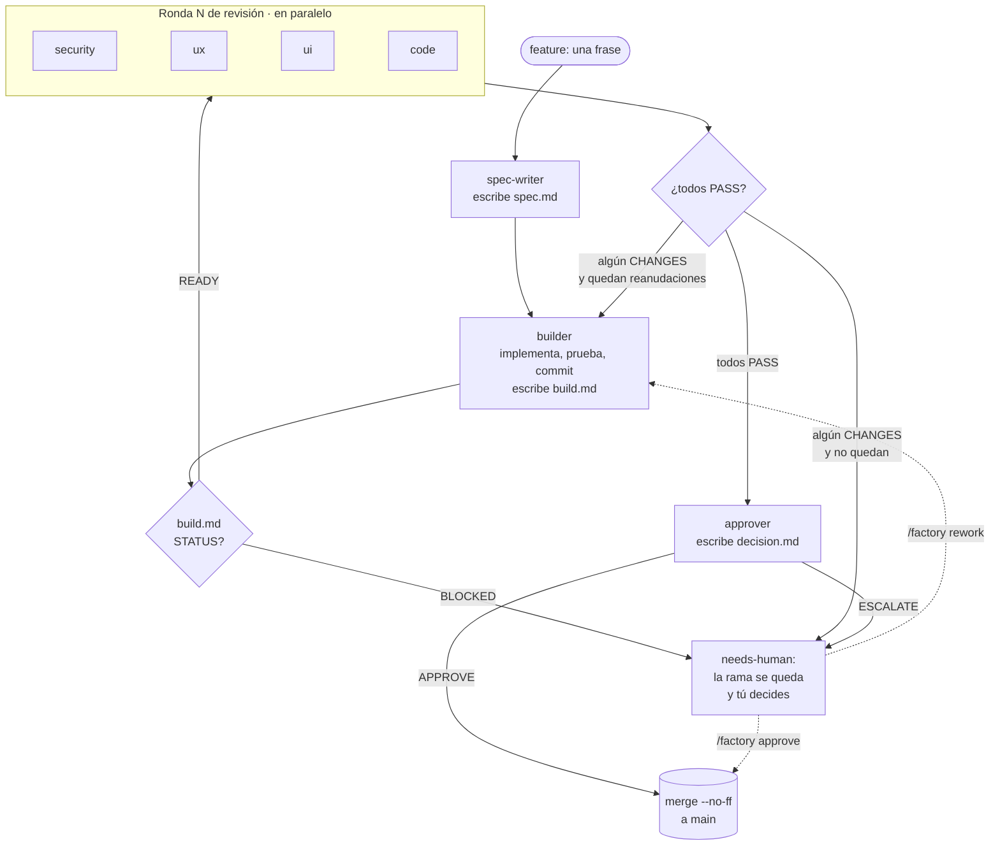
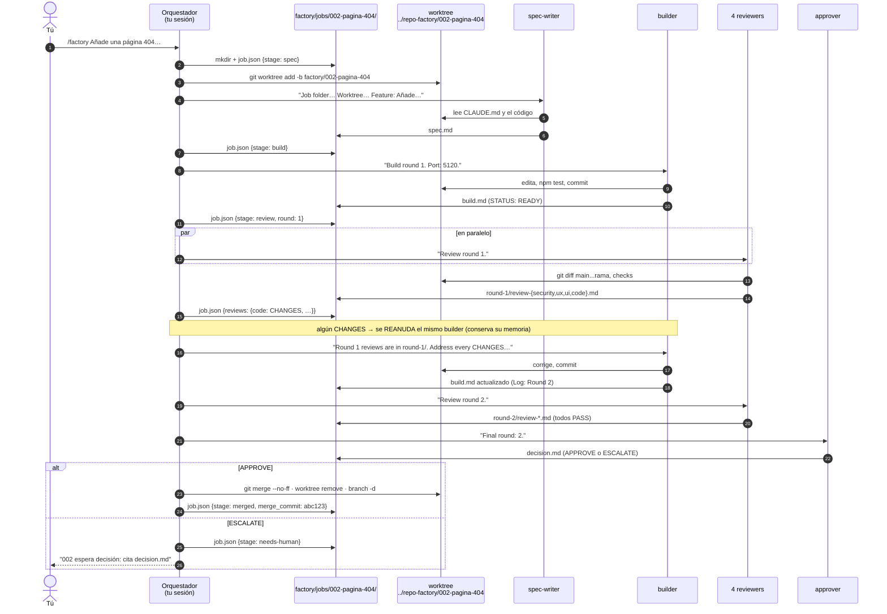
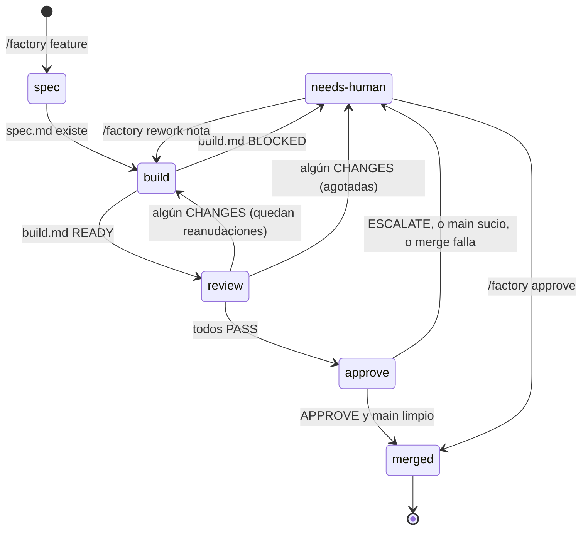
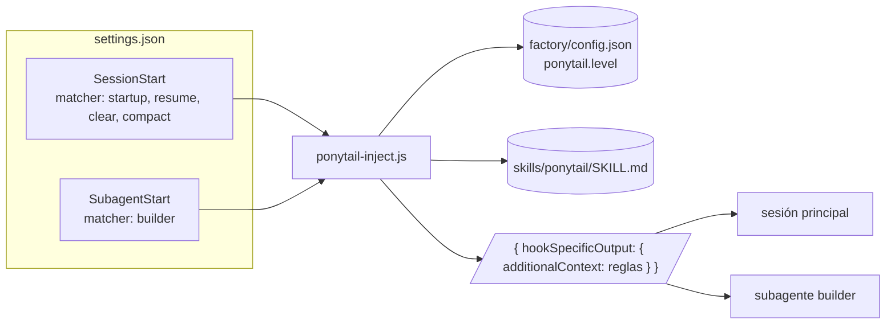
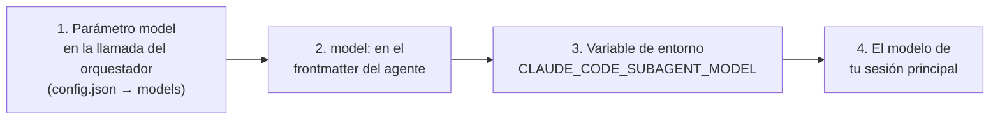

# La fábrica de software — documentación completa

> Para quien va a usarla, mantenerla o explicársela a otra persona. No hace
> falta saber nada de agentes de antemano: cada concepto se explica la primera
> vez que aparece. Si solo quieres arrancar, ve a [§11 Instalación](#11-instalación-en-tu-proyecto)
> y vuelve aquí cuando algo no te cuadre.
> Para empezar una app **desde cero** o meter la fábrica en una existente, hay
> una guía aparte: [`SCAFFOLD.md`](SCAFFOLD.md).

**Índice**

1. [Qué es esto, en una página](#1-qué-es-esto-en-una-página)
2. [Cómo funciona de principio a fin](#2-cómo-funciona-de-principio-a-fin)
3. [Los agentes](#3-los-agentes)
4. [Las skills](#4-las-skills)
5. [Los modelos](#5-los-modelos)
6. [Todo lo que se puede configurar](#6-todo-lo-que-se-puede-configurar)
7. [`CLAUDE.md`: lo único específico de tu proyecto](#7-claudemd-lo-único-específico-de-tu-proyecto)
8. [Comandos y el papel del humano](#8-comandos-y-el-papel-del-humano)
9. [El dashboard](#9-el-dashboard)
10. [Jobs en paralelo, Docker y modo desatendido](#10-jobs-en-paralelo-docker-y-modo-desatendido)
11. [Instalación en tu proyecto](#11-instalación-en-tu-proyecto)
12. [Límites, fallos conocidos y cómo salir de ellos](#12-límites-fallos-conocidos-y-cómo-salir-de-ellos)
13. [Preguntas frecuentes](#13-preguntas-frecuentes)
14. [Referencias](#14-referencias)
15. [Glosario](#15-glosario)

---

> **Novedades del 29/10/2026** (lo aprendido en una semana de uso real, [`DECISIONES.md`](DECISIONES.md)):
> `/nuevo-proyecto` crea un proyecto nuevo con la fábrica y su spec (README); el estado de la fábrica es un contrato de
> ficheros que cualquier interfaz puede leer, [`DATOS.md`](DATOS.md), y el dashboard pasa a ser un servicio de desarrollo
> opcional (`--profile dev`) que además aprueba jobs y pausa la fábrica; las ramas escriben `D-NEW` y el orquestador
> numera al fusionar (`factory/renumerar.py`); un conflicto con `main` lo resuelve un builder, no el humano; dos lentes
> por defecto y `ux`/`ui` solo si el diff toca `config.web_paths`; `/factory resume` para jobs huérfanos;
> `factory/metrics.py` mide cada job; `factory/cron/factory-next.sh` la hace desatendida, un job a la vez. Las secciones
> de abajo describen el bucle original; donde difieran, mandan la skill `factory` y `DECISIONES.md`.


## 1. Qué es esto, en una página

Una **fábrica de software** es una cadena de montaje para features. Tú pones
en la entrada una frase ("añade una página 404") y en la salida aparece un
cambio fusionado en `main`, o bien el cambio aparcado con una pregunta
concreta para ti. En medio no hay magia: hay siete **agentes** (instancias de
Claude con un papel fijo, un prompt fijo y unas herramientas limitadas) que se
pasan el trabajo a través de **ficheros markdown**, igual que en una fábrica
real cada puesto deja una hoja de ruta con la pieza.

La analogía que mejor funciona es la de un taller con inspectores:

| En un taller | En la fábrica |
| --- | --- |
| El jefe de planta: reparte el trabajo, no toca la pieza | El **orquestador** (`/factory`): lanza agentes, nunca escribe código |
| El ingeniero que redacta el pliego de la pieza | **spec-writer**: convierte la frase en una spec con criterios comprobables |
| El operario que fabrica la pieza en su mesa | **builder**: implementa en una rama propia, prueba y hace commit |
| Cuatro inspectores que miran la pieza a la vez, cada uno con una lupa distinta | **reviewer-security / ux / ui / code**: revisan en paralelo y votan PASS o CHANGES |
| Devolver la pieza a la mesa con las notas de los inspectores | Reanudar el **mismo builder** con las reviews (como mucho dos veces) |
| El responsable de calidad que firma la salida | **approver**: APPROVE (se fusiona solo) o ESCALATE (te la deja a ti) |
| La hoja de ruta que acompaña a la pieza | `factory/jobs/<job-id>/`: `spec.md`, `build.md`, `round-N/review-*.md`, `decision.md` |
| La mesa de trabajo de ese operario, separada de las demás | El **worktree** de git del job, en la rama `factory/<job-id>` |
| El panel luminoso de la planta | El **dashboard** (`factory/dashboard/`) |

Tres propiedades que hacen que esto sea una fábrica y no "pedirle a Claude que
programe":

1. **Separación de poderes.** Solo el builder puede editar código. Los
   revisores y el approver solo leen. El orquestador solo mueve el estado.
   Nadie corrige su propio trabajo.
2. **Comunicación por ficheros, no por conversación.** Cada agente arranca con
   el contexto limpio y lee lo que necesita de disco. Eso lo hace reproducible
   (puedes abrir cualquier fichero y ver qué vio cada uno) y permite
   paralelizar.
3. **Puertas con criterio explícito.** Cada fichero de revisión empieza por
   `VERDICT: PASS` o `VERDICT: CHANGES`; la decisión final empieza por
   `APPROVE` o `ESCALATE`. Son las únicas palabras que el orquestador y el
   dashboard interpretan; el resto es prosa para humanos.

Este repositorio además **no depende de nada instalado fuera de él**: las
skills de terceros (ponytail, thermo-nuclear) están copiadas dentro con su
licencia, y el hook que las activa es un fichero propio de 80 líneas.

---

## 2. Cómo funciona de principio a fin

### 2.1 El bucle



Cada caja es un agente distinto con su propio prompt (`.claude/agents/*.md`).
Las flechas las ejecuta el orquestador (`.claude/skills/factory/SKILL.md`),
que es la sesión de Claude Code en la que tú tecleaste `/factory`.

### 2.2 Un job, paso a paso

Supón que escribes `/factory Añade una página 404 para rutas desconocidas`.



Observa dos detalles que suelen confundir:

- **El código se escribe en el paso 2 (builder), no al final.** Las revisiones
  y la aprobación son inspecciones sobre commits que ya existen en la rama.
  "Merge" solo mueve esos commits a `main`.
- **El builder se reanuda, no se relanza.** Claude Code permite retomar un
  subagente por su nombre (`builder-<job-id>`) con `SendMessage`; conserva
  todo lo que leyó y pensó en la ronda anterior. Por eso corrige rápido. Un
  `/factory rework`, en cambio, lanza un builder nuevo que lee la historia de
  disco.

### 2.3 Los dos lugares: papeleo y código

Hay **dos directorios** distintos por job, y conviene tenerlo clarísimo:

```
<tu-repo>/                               ← checkout principal: TU sesión vive aquí
├── .claude/                                skills, agentes, hooks (commiteado)
├── factory/
│   ├── config.json                         configuración (commiteado)
│   ├── backlog.md                          cola (commiteado)
│   └── jobs/                               ESTADO DE EJECUCIÓN (en .gitignore)
│       └── 002-pagina-404/                 ← "la hoja de ruta": solo markdown y json
│           ├── job.json                    etapa, ronda, veredictos (lo escribe el orquestador)
│           ├── spec.md                     (spec-writer)
│           ├── build.md                    (builder; reescrito cada ronda)
│           ├── round-1/review-security.md  (reviewer-security)
│           ├── round-1/review-ux.md        …
│           ├── round-2/…
│           ├── rework-1.md                 (tú, vía /factory rework)
│           └── decision.md                 (approver)
└── CLAUDE.md

<tu-repo>-factory/                       ← al lado del repo (config.worktree_dir)
└── 002-pagina-404/                      ← "la mesa de trabajo": un git worktree
    ├── .git  → apunta al .git del repo principal
    ├── src/…                                aquí se edita y se commitea (rama factory/002-pagina-404)
    └── node_modules/                        instalado por el orquestador en el paso 2
```

Un **worktree** es una segunda copia de trabajo del mismo repositorio git,
en otra carpeta y en otra rama, que comparte el historial. Permite que el
builder rompa lo que quiera sin tocar tu checkout, y que varios jobs corran a
la vez. Cuando el job se fusiona, el orquestador borra el worktree y la rama;
si acaba en `needs-human`, los deja para que los inspecciones.

### 2.4 Estados de un job

`job.json` tiene un campo `stage`. Es lo que el dashboard pinta como columnas.



### 2.5 Rondas, reanudaciones y el límite

- La primera revisión es la **ronda 1**. Si alguna lente dice `CHANGES`, el
  builder se reanuda y después viene la ronda 2, y así.
- `max_resumes` (en `factory/config.json`, por defecto `2`) limita cuántas
  veces se reanuda el builder tras la ronda 1. Con `2`, un job tiene **como
  mucho 3 rondas**. Si en la tercera sigue habiendo `CHANGES`, el orquestador
  escribe él mismo un `decision.md` con `ESCALATE` y el job pasa a
  `needs-human`.
- Un `/factory rework` reinicia el contador: el builder nuevo vuelve a tener
  `max_resumes` reanudaciones.
- Una ronda **nunca se interrumpe a medias**: aunque la primera review en
  llegar diga `CHANGES`, el orquestador espera a las cuatro antes de reanudar
  al builder. Así el builder recibe todos los hallazgos de golpe.

### 2.6 Qué pasa al final

**Merge automático.** Solo si el approver dice `APPROVE` **y** tu checkout
principal está limpio y en `main`. Se hace con `git merge --no-ff`, de modo que
cada job deja un commit de merge identificable (`Merge factory/002-pagina-404`),
cuyo hash se guarda en `job.json → merge_commit`. El dashboard lo usa para
enseñarte el diff aunque la rama ya no exista. **Nunca se hace push**: subir a
un remoto es siempre decisión tuya.

**needs-human.** Ocurre por cinco motivos, y el dashboard te dice cuál:
`build.md` dice `BLOCKED`; se agotaron las rondas; el approver escaló (cita
`decision.md → For the human`); tu `main` estaba sucio en el momento del
merge; o el merge dio conflicto. En todos los casos la rama y el worktree se
quedan intactos. Tú lees, decides y ejecutas `/factory approve <id>` o
`/factory rework <id> <nota>`.

---

## 3. Los agentes

Un agente es un fichero markdown en `.claude/agents/` con un bloque de
cabecera (frontmatter YAML) y un prompt. Claude Code lo convierte en un
**subagente**: una instancia de Claude con ese prompt como instrucciones,
solo las herramientas listadas y el modelo indicado. El orquestador lo lanza
por su `name`.

### 3.1 Tabla resumen

| Agente | Modelo | Herramientas | Lee | Escribe | Skill precargada | ¿En el bucle por defecto? |
| --- | --- | --- | --- | --- | --- | --- |
| `spec-writer` | opus | Read, Grep, Glob, Bash, Write | `CLAUDE.md`, el código que toca la feature | `spec.md` | — | Sí |
| `builder` | opus | Read, Grep, Glob, Bash, **Edit, Write** | `CLAUDE.md`, `spec.md`, reviews de la ronda anterior, `rework-*.md` | commits en la rama + `build.md` | ponytail (por hook) | Sí |
| `reviewer-security` | opus | Read, Grep, Glob, Bash, Write | `CLAUDE.md`, spec, build, diff | `round-N/review-security.md` | — | Sí |
| `reviewer-ux` | sonnet | Read, Grep, Glob, Bash, Write | ídem + la app en el navegador | `round-N/review-ux.md` | — | Sí |
| `reviewer-ui` | sonnet | Read, Grep, Glob, Bash, Write | ídem + tema/estilos | `round-N/review-ui.md` | — | Sí |
| `reviewer-code` | sonnet | Read, Grep, Glob, Bash, Write | ídem + ejecuta tests/lint | `round-N/review-code.md` | `ponytail-review` | Sí |
| `reviewer-maintainability` | sonnet | Read, Grep, Glob, Bash, Write | ídem | `round-N/review-maintainability.md` | `thermo-nuclear-code-quality-review` | **No** (opcional) |
| `approver` | opus | Read, Grep, Glob, Bash, Write | todo lo anterior + `git merge-tree` | `decision.md` | — | Sí |

`Write` aparece en todos porque cada uno escribe **su** fichero de la carpeta
del job; el prompt les prohíbe tocar cualquier otro. Solo el builder tiene
`Edit`, y es el único al que el prompt permite cambiar código.

### 3.2 Qué hace cada uno

**spec-writer.** Lee `CLAUDE.md` y el código real implicado (le exigimos citar
rutas, no adivinar nombres) y escribe `spec.md` con cinco secciones:
`Context`, `Requirements`, `Acceptance criteria`, `Out of scope`, `Assumptions`.
La sección que más vale es la de criterios de aceptación: cada uno tiene que
ser **comprobable por alguien que solo tenga el repo** ("`npm run build`
termina con `✓ built`", "la página `/x` muestra `y`"). Esa lista es el plan de
pruebas del builder y la checklist del approver. `Assumptions` es la válvula
de escape: lo que la petición no dejaba claro y el spec-writer decidió; si es
una decisión de producto, el approver escalará.

**builder.** Trabaja en el worktree. Lee la spec, implementa el cambio más
pequeño que la cumple entera (ponytail refuerza esto, ver §4.3), ejecuta los
comandos de validación de `CLAUDE.md`, comprueba los criterios visibles en el
navegador si tiene `agent-browser`, y commitea con mensajes de una línea. Al
final escribe `build.md`: primera línea `STATUS: READY` o `STATUS: BLOCKED`,
resumen, criterios marcados `[x]` con la evidencia, validación y un `Log` por
ronda. `BLOCKED` es para cuando la spec se contradice, hace falta una decisión
humana o el entorno falla; le pedimos que no lo disimule.

**reviewer-security.** Control de acceso, entrada sin validar, XSS, fugas de
datos, pagos/identidad, abuso sin rate limit, secretos en commits,
dependencias nuevas. Solo bloquea por problemas reales **del cambio**; lo
preexistente va a `Notes`. Es el único reviewer en Opus: un falso PASS aquí
cuesta más que en los otros.

**reviewer-ux.** Usa la app como un visitante: flujo sin callejones sin
salida, estados de carga/vacío/error, caminos para cada tipo de usuario,
textos, accesibilidad, móvil. Si no hay cambio visible, PASS y lo dice.

**reviewer-ui.** Coherencia visual: colores, tipografía, espaciado, uso del
sistema de estilos existente, nada desbordado a ancho de teléfono, contraste.

**reviewer-code.** Corrección, simplicidad, reutilización, convenciones,
docs, commits, y que cada atajo lleve su comentario `shortcut:`. Además
**ejecuta** los checks de `CLAUDE.md` (un check que falla es `CHANGES`
siempre). Arranca con la skill `ponytail-review` precargada, que le da el
método (correcto → seguro → aguanta carga → probado → rápido → lean).

**reviewer-maintainability (opcional).** Aplica la rúbrica thermo-nuclear
(§4.6) al diff. No corre por defecto; se activa por job o en la configuración.

**approver.** Última puerta. Relee todo, comprueba al menos un criterio por su
cuenta, verifica que no hay conflictos con `git merge-tree`, y escala si el
cambio toca dinero, acceso, identidad, deploy/CI/hosting, migraciones, email,
datos de producción, dependencias nuevas, decisiones de producto, o lo que
`CLAUDE.md` reserve a humanos. `decision.md` empieza por `APPROVE` o
`ESCALATE` y, si escala, dice exactamente qué tienes que decidir y qué
ficheros mirar.

### 3.3 El protocolo de ficheros

Es lo único "rígido" del sistema, y conviene no romperlo si editas los agentes:

| Fichero | Primera línea obligatoria | Quién la lee |
| --- | --- | --- |
| `build.md` | `STATUS: READY` o `STATUS: BLOCKED` | orquestador, dashboard |
| `round-N/review-<lente>.md` | `VERDICT: PASS` o `VERDICT: CHANGES` | orquestador, dashboard, builder, approver |
| `decision.md` | `APPROVE` o `ESCALATE` | orquestador, dashboard, tú |
| `spec.md` | `# <título>` | builder, reviewers, approver |

Los títulos de sección (`## Findings`, `## Acceptance criteria`…) se quedan
en inglés porque los agentes siguientes los buscan por nombre. El contenido va
en castellano (o en el idioma del repo).

---

## 4. Las skills

### 4.1 Skill, agente y hook: tres cosas distintas

| | Qué es | Cuándo actúa | Dónde vive |
| --- | --- | --- | --- |
| **Skill** | Un `SKILL.md` con instrucciones reutilizables. Un manual de procedimiento. | Cuando alguien la invoca (`/nombre`), cuando Claude decide aplicarla, o cuando un agente la lleva **precargada** | `.claude/skills/<nombre>/SKILL.md` |
| **Agente** | Un prompt + herramientas + modelo. Un puesto de trabajo. | Cuando el orquestador lo lanza | `.claude/agents/<nombre>.md` |
| **Hook** | Un script que Claude Code ejecuta en un evento (arranca sesión, arranca subagente, antes de una herramienta…). Un interruptor automático. | Siempre que ocurre el evento | `.claude/settings.json` → `.claude/hooks/*.js` |

En este repo las skills de terceros llegan a los agentes por **dos vías**:

- **Precarga** (`skills:` en el frontmatter del agente): Claude Code inyecta
  el contenido completo de la skill al arrancar el subagente. Así reciben
  `reviewer-code` → `ponytail-review` y `reviewer-maintainability` →
  `thermo-nuclear-code-quality-review`. Es determinista: no depende de que el
  agente "se acuerde" de invocarla.
- **Hook** (`SubagentStart` en `settings.json`): un script lee la skill y la
  inyecta como contexto. Así recibe el `builder` → `ponytail`. Se usa el hook y
  no la precarga porque ponytail tiene **niveles** (lite/full/ultra) y el
  script filtra la skill según el nivel configurado.

### 4.2 `factory` — el orquestador

`.claude/skills/factory/SKILL.md`. Es la skill que tú invocas. Lleva
`disable-model-invocation: true`: Claude nunca la lanza por su cuenta aunque
le pidas "construye la feature X"; solo arranca cuando tecleas `/factory`.
Todo lo que hace está en §2 y §8. Si quieres cambiar el bucle (añadir un paso,
cambiar el orden, cambiar qué se escribe en `job.json`), se edita aquí.

### 4.3 `ponytail` — menos código

Origen: [DietrichGebert/ponytail](https://github.com/DietrichGebert/ponytail)
(MIT). Es un ruleset de ~50 líneas que convierte al agente en "el senior
perezoso": resuelve el problema entero con el **mínimo código nuevo**,
reutiliza lo que ya hay en el repo, la librería estándar y la plataforma antes
de escribir nada, no añade abstracciones ni opciones que nadie pidió, y nunca
recorta validación, manejo de errores, seguridad ni accesibilidad. El autor lo
mide en un benchmark propio (≈ −53 % de líneas, −26 % de coste frente al mismo
agente sin la skill, 39 tareas × 5 ejecuciones, Opus 5.5); trátalo como
orientativo, no como promesa para tu repo.

**Niveles.** La skill define tres:

| Nivel | Comportamiento |
| --- | --- |
| `lite` | Construye lo pedido; nombra en una línea la opción más pequeña y deja elegir |
| `full` | Las reglas completas (por defecto) |
| `ultra` | Además cuestiona la petición: antes de construir, discute cada parte que la necesidad no justifica |
| `off` | No se inyecta nada |

**Cómo llega al builder.** `.claude/settings.json` registra el hook
`.claude/hooks/ponytail-inject.js` en dos eventos:



El script lee el nivel de `factory/config.json`, lee el `SKILL.md`, se queda
solo con la fila de la tabla de niveles que toca, y devuelve el texto como
`additionalContext`, que Claude Code añade al contexto de la sesión o del
subagente. Falla "abierto": cualquier error → no inyecta nada y la sesión
sigue. Tarda ~40 ms.

**Por qué solo en el builder.** Los reviewers y el approver no escriben
código; cargarles 3 KB de reglas sobre cómo escribirlo es ruido. El `matcher`
de `SubagentStart` lo limita a `builder`. Si quieres que otro agente lo
reciba, cambia el matcher a `builder|reviewer-code` (es una expresión
regular).

**Cómo cambiar el nivel o apagarlo.** Edita `factory/config.json`:

```json
"ponytail": { "level": "lite", "session": true }
```

`level` se lee en cada arranque de sesión y de subagente, así que el siguiente
job lo usa sin reiniciar nada. `session: false` deja de inyectarlo en tu
sesión principal (el orquestador no escribe código, pero si usas el repo para
programar a mano te interesa tenerlo).

**Los comentarios `shortcut:`.** Cuando ponytail toma un atajo con un límite
conocido, deja un comentario con la forma
`shortcut: <el límite>, <cuándo mejorarlo>`. `reviewer-code` comprueba que
cada atajo lo lleve y `/ponytail-debt` los recoge todos (§4.5). Es la forma de
que "más adelante" no se convierta en "nunca".

### 4.4 `ponytail-review` — la lupa del revisor de código

Precargada en `reviewer-code`. Define el método de revisión: leer el diff
**y el código que toca** (llamadores, llamados, tests), rastrear el flujo real
de datos, y juzgar en este orden: correcto, seguro, aguanta carga, probado,
rápido, lean. Cada hallazgo se explica en lenguaje llano. El formato de salida
sigue siendo el de la fábrica (`VERDICT:` + Findings + Notes); la skill solo
aporta el criterio.

### 4.5 `ponytail-audit` y `ponytail-debt` — para ti, no para el bucle

Las dos llevan `disable-model-invocation: true`: solo corren si las tecleas.

- `/ponytail-audit [carpeta]`: auditoría de **todo el repo** (o una carpeta):
  bugs, agujeros de seguridad, qué se rompe con carga, código arriesgado sin
  tests, qué borrar o fusionar. Informe ordenado por importancia; no cambia
  nada. Útil antes de meter la fábrica en un repo heredado.
- `/ponytail-debt [palabra]`: lista todos los comentarios `shortcut:` del repo
  como un libro de deuda (`fichero:línea, qué se simplificó, techo, cuándo
  revisarlo`), y marca los que no tienen disparador. Útil cada N jobs.

No se incluyen `ponytail-gain` (tarjeta con los números del benchmark del
autor; no mide nada tuyo) ni `ponytail-help` (referencia de comandos del
plugin original). Tampoco la "band" (barra de coste/tokens en Claude Code
≥ 2.1.290): es una extensión de interfaz del plugin, no una skill, y queda
fuera del objetivo de autocontención. Si la quieres, instala el plugin
oficial aparte; no choca con este repo.

### 4.6 `thermo-nuclear-code-quality-review` — el reviewer opcional

Origen: [cursor/plugins → thermos](https://github.com/cursor/plugins/tree/main/thermos)
(MIT). Es una rúbrica de **mantenibilidad extremadamente estricta**: busca
movimientos de "code judo" (reestructurar para que desaparezcan ramas, capas o
modos enteros), no deja que un fichero cruce las 1.000 líneas sin una razón
muy fuerte, trata cada `if` ad hoc en un flujo compartido como un problema de
diseño, y no aprueba "porque funciona". Tono directo y exigente.

**No está en el bucle por defecto**, y la razón es de ingeniería, no de
calidad: ponytail empuja al builder hacia *menos código* y thermo-nuclear
empuja al revisor hacia *más estructura*. En un bucle con solo dos
reanudaciones, dos fuerzas opuestas pueden no converger y mandar jobs sanos a
`needs-human`. Pruébala por job y mide:

- Por job: `/factory <feature> --with maintainability`
- Siempre: en `factory/config.json`, mueve `"maintainability"` de
  `optional_reviewers` a `reviewers`.

El agente `reviewer-maintainability` la lleva precargada y añade tres reglas
de encaje: aplicar la rúbrica **solo al diff**, convertir las ambiciones
estructurales en hallazgos que quepan en una ronda (lo demás a `Notes` como
deuda), y pedir la estructura más simple, nunca más capas por principio.

Nota técnica: la skill original lleva `disable-model-invocation: true`, que en
Claude Code impide precargarla en subagentes. La copia vendorizada lo quita;
es el único cambio.

### 4.7 Cómo añadir otra skill

1. Copia su `SKILL.md` a `.claude/skills/<nombre>/SKILL.md` (con su licencia
   en `THIRD_PARTY_LICENSES.md`). Si lleva `disable-model-invocation: true` y
   la quieres en un agente, quítalo.
2. Decide la vía:
   - **Precarga** en un agente existente: añade `skills: [<nombre>]` a su
     frontmatter (lista YAML; hasta 32 nombres).
   - **Nuevo reviewer**: crea `.claude/agents/reviewer-<lente>.md` copiando
     uno existente, con `skills: [<nombre>]`, salida `VERDICT:` en la primera
     línea y fichero `round-N/review-<lente>.md`. Añade `<lente>` a
     `reviewers` u `optional_reviewers` en `config.json`. El dashboard pinta
     el chip solo.
   - **Hook**: solo si necesita lógica (niveles, condiciones). Copia el patrón
     de `ponytail-inject.js`.
3. Nada más: no hay registro central. Claude Code descubre `.claude/skills/` y
   `.claude/agents/` al arrancar la sesión.

---

## 5. Los modelos

### 5.1 Qué modelo usa cada agente y por qué

| Agente | Modelo | Motivo |
| --- | --- | --- |
| spec-writer | `opus` | Una spec mal planteada arrastra todo el job. Aquí la calidad de razonamiento es lo que más pesa. |
| builder | `opus` | Escribe el código y se reanuda varias veces; es el agente con más contexto y más decisiones. |
| reviewer-security | `opus` | Un falso PASS en seguridad es el error más caro del bucle. |
| reviewer-ux / ui / code / maintainability | `sonnet` | Revisan contra una spec y un diff concretos; es trabajo de comparación, donde Sonnet rinde bien a una fracción del coste. |
| approver | `opus` | Decide un merge sin humano. |

`opus` y `sonnet` son **alias**: Claude Code los resuelve a la versión actual
de cada familia (en octubre de 2026, Claude Opus 5.5 y Claude Sonnet 5.5).
Cuando salga una versión nueva, los alias la cogen solos. Si quieres fijar una
versión concreta, usa el ID completo (por ejemplo `claude-opus-5-5`).

### 5.2 Sí, se pueden cambiar. Cuatro sitios, por orden de prioridad

Claude Code resuelve el modelo de un subagente en este orden (gana el primero
que esté definido):



| Dónde | Cómo | Cuándo usarlo |
| --- | --- | --- |
| `factory/config.json → models` | `"builder": "sonnet"` (en vez de `null`). El orquestador pasa ese valor como parámetro `model` al lanzar el agente. | Cambiar modelos **sin tocar los agentes**, por proyecto. Es la forma recomendada. |
| Frontmatter del agente | `model: sonnet` en `.claude/agents/<agente>.md` | Cambiar el valor por defecto que viaja con el agente a otros repos. |
| `CLAUDE_CODE_SUBAGENT_MODEL` | Variable de entorno antes de arrancar `claude` | Forzar un modelo a **todos** los agentes que no tengan modelo explícito (ninguno de los nuestros, salvo que pongas `inherit`). Útil en Docker. |
| `inherit` | `model: inherit` en el frontmatter | Que el agente use el mismo modelo que tu sesión. |

Valores admitidos en cualquiera de los cuatro: `opus`, `sonnet`, `haiku`,
`fable`, `inherit` o un ID completo de modelo.

**Recomendaciones honestas.** Bajar `builder` a Sonnet funciona en features
pequeñas y abarata mucho; en cuanto el cambio toca varias capas, sube el
número de rondas y acabas pagando lo mismo en reviews. No bajes
`reviewer-security` ni `approver` si vas a fusionar sin mirar. Subir los
reviewers de UX/UI a Opus rara vez cambia el veredicto. Haiku solo para
experimentar con el bucle en un repo de juguete.

### 5.3 Cuánto cuesta un job

Sin reanudaciones, un job son **7 ejecuciones de agente**: 4 en Opus
(spec-writer, builder, reviewer-security, approver) y 3 en Sonnet. Cada
reanudación añade 1 Opus (builder) + 4 reviews (1 Opus + 3 Sonnet). El
`reviewer-maintainability` opcional añade 1 Sonnet por ronda. Lo que más
tokens consume no son los prompts de la fábrica (son cortos) sino lo que cada
agente lee del repo: un `CLAUDE.md` preciso y una spec con rutas concretas
reducen el coste más que cualquier cambio de modelo.

Otros dos parámetros de frontmatter afectan al coste y están documentados en
§6.2: `effort` (nivel de razonamiento) y `maxTurns` (tope de turnos de un
subagente).

---

## 6. Todo lo que se puede configurar

### 6.1 `factory/config.json`

Lo lee el orquestador al empezar cada job y el dashboard en cada refresco.

| Clave | Tipo | Por defecto | Qué hace | ¿Tocar? |
| --- | --- | --- | --- | --- |
| `reviewers` | lista | `["security","ux","ui","code"]` | Lentes que corren en **cada** ronda. Para cada `<lente>` tiene que existir `.claude/agents/reviewer-<lente>.md`. | Sí: quita `ui` en un proyecto sin interfaz; añade `maintainability` si la quieres siempre. |
| `optional_reviewers` | lista | `["maintainability"]` | Lentes disponibles para `--with`. | Sí, al añadir reviewers nuevos. |
| `reviewers_policy` | `siempre`/`segun-cambio` | `"siempre"` | Con `segun-cambio`, `security` solo corre si el diff toca `security_paths`; `code` siempre. | Sí, tras ajustar `security_paths`: en 124 revisiones de un proyecto real solo una encontró algo. |
| `security_paths` | lista de globs | API, servidor, docker, scripts, dependencias | Qué cuenta como «toca algo con riesgo». | Ajústalos a tus carpetas antes de usar `segun-cambio`. |
| `builder_small_model` | cadena o `null` | `null` | Modelo del builder si la spec dice `Tamaño: pequeño`. | `"sonnet"` para pulidos de interfaz. |
| `modo` | `cron`/`encadenado` | `"cron"` | `encadenado`: un job en cuanto acaba el anterior (cron cada 5 min). `cron`: espera `intervalo_min`. | `encadenado` si el límite de la cuenta te deja ir más rápido. |
| `intervalo_min` | entero | `30` | Minutos entre inicios en modo `cron`. | Sí. |
| `max_resumes` | entero | `2` | Reanudaciones del builder tras la ronda 1 (rondas máximas = `max_resumes + 1`). | Con cuidado: `3` da margen a features grandes; `1` ahorra en repos maduros con reviews estrictas. |
| `port_base` | entero | `5100` | Puerto base. Job `n` usa `port_base + 10n` (builder), `+1` (ux), `+2` (ui). | Si chocan con algo tuyo. |
| `worktree_dir` | cadena | `"../{name}-factory"` | Dónde se crean los worktrees, relativo al repo; `{name}` = nombre de la carpeta del repo. | `"factory/worktrees"` para tenerlos dentro del repo (ya está en `.gitignore`); práctico en Docker. |
| `models.<agente>` | cadena o `null` | `null` | Modelo que el orquestador pasa al lanzar ese agente. `null` = el del frontmatter. | Ver §5.2. |
| `ponytail.level` | `off`/`lite`/`full`/`ultra` | `"full"` | Nivel que inyecta el hook. | Ver §4.3. |
| `ponytail.session` | booleano | `true` | Inyectar también en la sesión principal. | `false` si solo quieres ponytail en el builder. |

### 6.2 Frontmatter de los agentes (`.claude/agents/*.md`)

Campos que usamos y campos que puedes añadir. Todos documentados en la
[referencia de subagentes](https://code.claude.com/docs/en/sub-agents).

| Campo | Lo usamos | Qué hace |
| --- | --- | --- |
| `name` | sí | Identificador por el que el orquestador lo lanza. No lo cambies sin cambiar `SKILL.md`. |
| `description` | sí | Cuándo delegar en él. Informativo aquí (la fábrica lo lanza por nombre). |
| `tools` | sí | Lista blanca de herramientas. Es la barrera de seguridad: sin `Edit`, un reviewer no puede editar código aunque quiera. |
| `model` | sí | Ver §5. |
| `skills` | en `reviewer-code` y `reviewer-maintainability` | Skills precargadas al arrancar (contenido completo, no solo la descripción). Máximo 32. No admite skills con `disable-model-invocation: true`. |
| `effort` | no | `low` · `medium` · `high` · `xhigh` · `max`. Nivel de razonamiento; sube calidad y coste. Candidato natural: `approver` o `builder` en features difíciles. |
| `maxTurns` | no | Tope de turnos del subagente. Un seguro contra un builder que se encalla; `BLOCKED` es mejor salida, pero esto es la red. |
| `permissionMode` | no | `default`, `acceptEdits`, `dontAsk`, `bypassPermissions`, `plan`. Por agente. Ver §10.3 antes de tocarlo. |
| `disallowedTools` | no | Lista negra, alternativa a `tools`. |
| `memory` | no | `user` / `project` / `local`: memoria persistente entre ejecuciones. No la usamos a propósito: la fábrica quiere agentes sin memoria entre jobs. |
| `isolation: worktree` | no | Claude Code crearía un worktree temporal por subagente. La fábrica gestiona los suyos (persisten entre agentes del mismo job), así que **no** lo actives. |
| `omitClaudeMd` | no | Arrancar sin `CLAUDE.md`. Rompería la fábrica: todo lo específico del repo viene de ahí. |

### 6.3 `.claude/settings.json` (hooks)

| Qué | Dónde | Cambiar para… |
| --- | --- | --- |
| Eventos en los que corre el hook | `hooks.SessionStart`, `hooks.SubagentStart` | Quitar `SessionStart` si no quieres ponytail en tu sesión (o `ponytail.session: false`, más cómodo). |
| A qué subagentes se inyecta | `SubagentStart[0].matcher` (regex) | `"builder\|reviewer-code"` para añadir el revisor de código. |
| Tiempo máximo del hook | `timeout` (segundos) | No hace falta; tarda milisegundos. |

Claude Code lee `.claude/settings.json` como ajustes de proyecto compartidos
(se commitea). Los ajustes personales van en `.claude/settings.local.json`
(en `.gitignore`).

### 6.4 `CLAUDE.md`

Ver §7. Es el parámetro más importante de todos.

### 6.5 Lo que no se configura (y por qué)

- **El formato de la primera línea** de `build.md`, `review-*.md` y
  `decision.md`. Es el contrato entre agentes, orquestador y dashboard.
- **Que el builder sea el único que edita código.** Es lo que hace fiable la
  revisión.
- **Que nunca se haga push.** El merge local es reversible; el push, no tanto.

---

## 7. `CLAUDE.md`: lo único específico de tu proyecto

Los agentes de la fábrica no saben nada de tu stack. Todo lo aprenden de
`CLAUDE.md` en la raíz del repo. Claude Code lo carga automáticamente en cada
sesión y en cada subagente, y además los agentes lo leen explícitamente al
empezar (si tu repo usa `AGENTS.md`, el nombre que leen otras herramientas,
también lo buscan). La plantilla incluida tiene estas secciones, y cada una
alimenta a alguien:

| Sección | Quién la usa | Qué pasa si falta |
| --- | --- | --- |
| **Qué es este proyecto** | spec-writer | Specs genéricas que no citan rutas reales. |
| **Rutas importantes** | spec-writer, reviewers | Agentes buscando a ciegas con grep; más tokens, más errores. |
| **Preparar un checkout nuevo** | orquestador (paso 2) | El worktree no tiene dependencias; el builder falla al primer `npm test`. |
| **Servidor de desarrollo** (en un puerto dado) | builder, reviewer-ux, reviewer-ui | Nadie puede mirar la página; las reviews visuales son "a ciegas". El comando tiene que aceptar el puerto y **fallar** si está ocupado (`--strictPort` en Vite), nunca saltar a otro. |
| **Validación** | builder, reviewer-code, approver | Sin tests/lint que ejecutar, un PASS es opinión, no verificación. |
| **Convenciones** | builder, reviewer-code | Más rondas por "convention breaks". |
| **Cambios que siempre necesitan un humano** | approver | El approver aplica su lista genérica (pagos, deploy, migraciones…). Añade lo que en tu proyecto sea delicado. |
| **Documentación por zona** | todos | Opcional. "Antes de tocar `functions/`, lee `docs/functions.md`". |

Regla práctica: si al leer tu `CLAUDE.md` una persona nueva podría preparar
el repo, arrancarlo y validar un cambio **sin preguntarte nada**, los agentes
también podrán.

---

## 8. Comandos y el papel del humano

| Comando | Qué hace | Cuándo |
| --- | --- | --- |
| `/factory <feature>` | Un job nuevo de principio a fin. | Lo normal. Escribe la feature como se la contarías a un compañero: qué, dónde, para quién. |
| `/factory <feature> --with maintainability` | Lo mismo, con el reviewer opcional en todas las rondas de ese job. | Cambios estructurales, refactors, código que vas a mantener años. |
| `/factory next` | Coge el primer `- [ ]` de `factory/backlog.md`, lo marca con el job id y lo construye. | Tienes una lista. Varias sesiones pueden hacer `next` a la vez sin pisarse (el reclamo del ítem es atómico). |
| `/factory approve <job-id>` | Fusiona un job que está en `needs-human`. | Leíste `decision.md` y estás de acuerdo. |
| `/factory rework <job-id> <nota>` | Escribe tu nota en `rework-k.md` y lanza un builder nuevo que la lee junto con toda la historia. Reinicia `max_resumes`. | No estás de acuerdo, o quieres un cambio concreto. La nota es el único canal: sé específico. |
| `/factory status` | Tabla de todos los jobs en el chat. | Sin abrir el dashboard. |

**Tu trabajo en el bucle** se reduce a tres momentos: escribir buenas
peticiones (y un buen `CLAUDE.md`), decidir en `needs-human`, y hacer push
cuando te parezca. Todo lo demás lo hace la fábrica. Lo que **no** deberías
hacer: editar a mano la rama `factory/<id>` mientras el job corre (el builder
no lo sabrá), ni tocar `factory/jobs/<id>/job.json` (solo lo escribe el
orquestador).

---

## 9. El dashboard

> El dashboard es **opcional**: un servicio de desarrollo aparte del producto (`docker compose -f docker/compose.yaml
> --profile dev up -d dashboard`), que lee `factory/` y escribe solo dos señales (aprobar un job, pausar la fábrica). Si
> tu proyecto no es Node o quieres otra vista, [`DATOS.md`](DATOS.md) es el contrato que tiene que cumplir cualquier
> interfaz; los datos siempre se quedan en `factory/`.

`factory/dashboard/` es un tablero en vivo escrito desde cero para esta
fábrica, inspirado en el de ZazenCodes (mismas columnas por etapa, mismos
chips por lente) y con dos añadidos: un servidor Node sin dependencias en vez
de parsear el índice de `python -m http.server`, y una pestaña **Cambios** que
enseña el diff real de la rama, o del commit de merge cuando la rama ya no
existe.

```bash
node factory/dashboard/server.mjs              # http://127.0.0.1:8989, lee factory/jobs/
node factory/dashboard/server.mjs --examples   # con los tres jobs de factory/examples/jobs/
node factory/dashboard/server.mjs --port 9000
```

Qué ves:

- **Seis columnas** = los seis valores de `stage`. Una tarjeta por job, con su
  id, la feature, **una fila de chips por ronda** (verde PASS, ámbar CHANGES,
  gris pulsante pendiente, rojo inválido o ausente), cuándo se actualizó y,
  si procede, `APPROVE`/`ESCALATE`/`BLOCKED`. Las columnas `needs-human` y
  `merged` tienen color propio para que destaquen.
- **Clic en una tarjeta** → panel con una pestaña por fichero del job
  (`spec.md`, `build.md`, `decision.md`, `job.json`, `R1 · code.md`…), el
  markdown renderizado y la primera línea destacada como etiqueta; y dos
  pestañas más: **Cambios (diff)** y **Commits**.
- La cabecera muestra de qué carpeta lee, los reviewers activos y
  `max_resumes`. Si arrancas con `--examples` lo avisa en ámbar.
- Se refresca cada 2 segundos y solo repinta si algo cambió. Déjalo abierto
  en un monitor mientras corren los jobs.

Cómo lee los datos (por si quieres construir encima):

| Endpoint | Devuelve |
| --- | --- |
| `GET /api/state` | `config` + todos los jobs, cada uno con `rounds` (veredictos por ronda, leídos de los ficheros `review-*.md`; la ronda en curso, de `job.json`), `files`, `decision`, `build_status`. |
| `GET /api/file?job=<id>&path=<fichero>` | El texto del fichero. Solo rutas de la forma `spec.md`, `round-N/review-x.md`, etc. |
| `GET /api/diff?job=<id>` | `git diff --stat --patch main...factory/<id>`, o `git diff <merge>^1 <merge>` si hay `merge_commit`. |
| `GET /api/log?job=<id>` | Los commits de la rama o del merge. |

Solo escucha en `127.0.0.1` y nunca escribe nada. `--host 0.0.0.0` existe para
Docker; no lo uses fuera.

**Por qué este y no el "board" de ponytail.** El board de ponytail muestra
coste, tokens y tiempo de agente por sesión, leído de los hooks de su plugin.
Mide *cuánto te cuesta* trabajar, no *en qué estado está cada feature*. Son
complementarios; para "ver los cambios" el tablero de etapas es el que
responde a la pregunta. Si quieres el de coste, instala el plugin oficial de
ponytail aparte (§4.5).

---

## 10. Jobs en paralelo, Docker y modo desatendido

### 10.1 Varios jobs a la vez

Abre varias sesiones de Claude Code en el mismo repo (varias terminales) y
lanza `/factory` en cada una. Funciona porque:

- cada job tiene su worktree y su rama (no comparten árbol de trabajo);
- cada job tiene su `job.json` (ninguna sesión escribe el fichero de otra);
- el número de job se reclama con `mkdir` sin `-p` (atómico: si dos sesiones
  quieren el `004`, una falla y coge el `005`);
- cada job usa puertos distintos (`port_base + 10n`) y sesiones distintas de
  `agent-browser`;
- el merge comprueba que `main` esté limpio justo antes de hacerlo.

Lo único compartido es `factory/backlog.md`, y el reclamo de un ítem es un
`Edit` de una línea exacta que falla si otra sesión la cambió antes.

### 10.2 Docker: la fábrica desatendida

Claude Code pregunta antes de cada herramienta con efectos (editar, ejecutar
comandos). En un bucle de 7–15 agentes eso son decenas de preguntas. La
opción `--dangerously-skip-permissions` las elimina, y el único sitio donde
es razonable usarla es **dentro de un contenedor** que solo ve tu repo.

```bash
docker compose -f docker/compose.yaml build          # imagen con node, git y Claude Code
docker compose -f docker/compose.yaml run --rm factory
# dentro del contenedor, la primera vez:
claude            # → /login (OAuth), queda guardado en el volumen factory-claude-home
# después:
claude --dangerously-skip-permissions
# y ya: /factory <feature>
```

Detalles de `docker/compose.yaml`:

- Monta el **directorio padre** del repo en `/work`, porque los worktrees
  viven al lado del repo (`../{name}-factory`). Si no quieres exponer los
  repos hermanos, pon `worktree_dir: "factory/worktrees"` en `config.json` y
  monta solo el repo.
- `REPO_DIR_NAME` (variable de entorno) si tu carpeta no se llama
  `factory-boilerplate`.
- `ANTHROPIC_API_KEY` se pasa al contenedor si existe en tu shell; es la
  alternativa al login OAuth.
- `WITH_AGENT_BROWSER=1` como argumento de build instala `agent-browser` y
  Chromium (la imagen crece ~1 GB).
- Para ver el dashboard desde el host: dentro del contenedor
  `node factory/dashboard/server.mjs --host 0.0.0.0`, y en el host
  <http://localhost:8989>.

Aviso: el contenedor tiene red (la necesita para hablar con la API). El
[devcontainer de referencia de Anthropic](https://github.com/anthropics/claude-code/tree/main/.devcontainer)
añade un cortafuegos con lista blanca; si vas a dejar la fábrica corriendo
sola sobre repos con secretos, copia esa idea.

### 10.3 Permisos sin Docker

Si prefieres no usar contenedor: `claude --permission-mode acceptEdits` acepta
las ediciones de ficheros sin preguntar pero sigue preguntando por los
comandos; y en `.claude/settings.local.json` puedes poner una lista `allow` de
comandos concretos (`npm test`, `git commit`, …). Es más trabajo de ajuste,
pero no abre nada fuera de lo que listes.

### 10.4 `agent-browser`

[vercel-labs/agent-browser](https://github.com/vercel-labs/agent-browser) es
una CLI con la que un agente abre un navegador real, navega, hace capturas y
lee el DOM. El builder y los reviewers de UX/UI la usan **si está
instalada**; si no, revisan leyendo el código y lo dicen en `Notes`. En
proyectos con interfaz merece la pena: convierte "parece que la página
funciona" en "la página muestra X en 1280 px y 390 px".

---

## 11. Instalación en tu proyecto

> Si la app no existe todavía, o existe pero no tiene tests ni servidor de
> desarrollo con puerto fijo, sigue primero [`SCAFFOLD.md`](SCAFFOLD.md): el
> scaffold y los cimientos van antes que estos pasos.

1. **Copia** `.claude/`, `factory/` y `CLAUDE.md` a la raíz de tu repo. Si ya
   tienes un `CLAUDE.md`, fusiona las secciones de §7 en él (los nombres de
   sección importan).
2. **Rellena `CLAUDE.md`** (§7). Es el paso que decide si la fábrica funciona.
3. **Borra los ejemplos** que no quieras: `factory/examples/` es solo para ver
   el dashboard; `factory/backlog.md` trae una línea de muestra.
4. **Comprueba `.gitignore`**: tiene que ignorar `factory/jobs/` (estado de
   ejecución) y, si usas `worktree_dir` dentro del repo, esa carpeta.
5. **Herramientas**: `node` ≥ 18 (lo exige Claude Code), `git`, y
   opcionalmente `agent-browser`.
6. **Commitea** todo en `main` y deja el árbol limpio (el merge lo exige).
7. **Prueba en seco**: `node factory/dashboard/server.mjs --examples` para
   ver el tablero, y en Claude Code `/factory status` (debe decir que no hay
   jobs).
8. **Primer job pequeño**: algo de una hora de trabajo humano, con interfaz
   si tu proyecto la tiene. Lee los cinco ficheros que genera; ajusta
   `CLAUDE.md` con lo que los agentes no supieron.

Para empezar un proyecto **desde este repo**: clónalo, borra `factory/examples/`,
sustituye `LICENSE` y `README.md` por los tuyos y añade tu código.

---

## 12. Límites, fallos conocidos y cómo salir de ellos

| Síntoma | Causa probable | Qué hacer |
| --- | --- | --- |
| El job va a `needs-human` con `BLOCKED` nada más empezar | `CLAUDE.md` no explica cómo preparar el checkout o el servidor; o el worktree no está en la rama esperada | Lee `build.md → ## Blocked`. Corrige `CLAUDE.md`, `/factory rework <id> "reintenta"`. |
| Rondas agotadas con el mismo hallazgo | Un reviewer pide algo fuera de la spec, o dos reviewers piden cosas opuestas | Lee las reviews. O `/factory rework` con una nota que zanje la discusión, o ajusta el prompt del reviewer para que lo lleve a `Notes`. |
| "aprobado pero el checkout principal está ocupado" | Tenías cambios sin commitear en `main` | Commitea o guarda (`git stash`), luego `/factory approve <id>`. |
| El builder no parece usar ponytail | El hook no disparó: Claude Code antiguo sin `SubagentStart`, `node` fuera del `PATH`, o `ponytail.level: off` | `claude --debug` y busca `ponytail-inject` en el log; prueba a mano `echo '{"hook_event_name":"SubagentStart"}' \| node .claude/hooks/ponytail-inject.js`. |
| Reviews de UX/UI "sin navegador" | `agent-browser` no instalado | Instálalo (§10.4) o acepta reviews por lectura. |
| El dashboard dice "La rama … no existe" en Cambios | Job de ejemplo, o job cuya rama borraste a mano sin registrar `merge_commit` | Normal en ejemplos. En jobs reales, no borres ramas a mano. |
| Puertos ocupados | Otro proceso en `5100+10n` | Cambia `port_base`. |
| En Windows, rutas raras en `job.json` | Git Bash escribe `/c/Users/...`; es correcto para git | Nada: git y Node las entienden. Usa Git Bash como shell de Claude Code, no `cmd`. |
| Coste más alto del esperado | `CLAUDE.md` vago → agentes leyendo medio repo; features demasiado grandes | Specs con rutas concretas; trocea la feature; baja reviewers a Sonnet si no lo están. |

Límites de diseño, asumidos a propósito:

- **No hay push ni PR.** Si tu flujo exige PR, cambia el paso **Merge** de
  `SKILL.md` por `git push -u origin factory/<id>` + `gh pr create`; el
  approver ya deja en `decision.md` el texto para la descripción.
- **Un job = una feature pequeña o mediana.** Una epic de una semana no cabe
  en 3 rondas; trocéala en el backlog.
- **Los agentes no hablan entre sí**, solo por ficheros. Es una limitación
  deliberada: lo hace auditable.
- **El cumplimiento de instrucciones es probabilístico.** Un prompt no es un
  sistema de permisos; por eso la barrera real son las `tools` del frontmatter
  (sin `Edit`, no se edita) y el worktree.

---

## 13. Preguntas frecuentes

**¿Puedo quitar un reviewer?** Sí: quítalo de `reviewers` en `config.json`.
En un backend sin interfaz, quita `ui` (y quizá `ux`).

**¿Puedo añadir un reviewer de rendimiento / de accesibilidad / de i18n?**
Sí: §4.7. Copia `reviewer-code.md`, cambia el nombre, el "Qué buscar" y el
fichero que escribe, añádelo a `reviewers`.

**¿Por qué el orquestador no escribe código él mismo? Sería más rápido.**
Porque entonces nadie lo revisaría con contexto limpio. La lentitud es el
precio de la separación de poderes.

**¿Los agentes ven mi conversación?** No. Cada subagente arranca vacío con su
prompt, `CLAUDE.md` y lo que lea de disco. Lo que tú le digas al orquestador
no llega al builder salvo a través de la feature y de `rework-k.md`.

**¿Qué pasa si cierro la terminal a mitad de un job?** El orquestador muere;
el `job.json` se queda en la última etapa escrita y el worktree intacto. No
hay "resume" automático: lanza `/factory rework <id> "continúa desde donde
estaba"` (un builder nuevo lee `build.md` y las rondas) o borra la carpeta del
job, el worktree (`git worktree remove`) y la rama, y empieza de nuevo.

**¿Funciona con otros lenguajes que no sean JavaScript?** Sí; la fábrica no
asume stack. Lo único que asume es que `CLAUDE.md` dice cómo instalar, correr
y validar. El Dockerfile instala `node` porque Claude Code lo necesita, no
porque tu proyecto deba usarlo.

**¿Y con Codex / Cursor / otros agentes?** Los agentes y skills están en el
formato de Claude Code. Ponytail y thermos existen también para otros hosts
(ver sus repos), pero el orquestador de la fábrica usa `SendMessage`,
subagentes con nombre y `SubagentStart`, que son de Claude Code.

**¿Cómo mido si ponytail me ayuda?** Mismas 5 features del backlog, dos
pasadas (`ponytail.level: off` y `full`), compara `git diff --stat` de cada
rama y el número de rondas por job en el dashboard. El benchmark del autor
está en `benchmarks/` de su repo si quieres reproducirlo con tu API key.

---

## 14. Referencias

**Origen del diseño**

- ZazenCodes, *Build Your Own AI Software Factory with Claude Code* —
  [vídeo](https://youtu.be/ctoaIC4LHmI) ·
  [código](https://github.com/zazencodes/zazencodes-season-3/tree/main/src/software-factory-claude-code)
  (`.claude/skills/factory/SKILL.md`, `.claude/agents/`, `factory/dashboard.html`,
  `BUILD_PROMPT.md` con el prompt que generó la fábrica original).
- Variantes de la comunidad que resuelven cosas que esta no:
  [mkbaker/factory](https://github.com/mkbaker/factory) (abre PR en vez de
  merge, jobs desde issues de GitHub, `/factory resume`),
  [candoit3721/software-factory](https://github.com/candoit3721/software-factory)
  (deploy tras el merge, dashboard multi-proyecto),
  [3mrhussein/software-factory](https://github.com/3mrhussein/software-factory)
  (`/factory-init` que investiga el repo y configura los roles).

**Skills vendorizadas**

- Ponytail — [repo](https://github.com/DietrichGebert/ponytail) ·
  [benchmarks](https://github.com/DietrichGebert/ponytail/tree/main/benchmarks) ·
  [hooks originales](https://github.com/DietrichGebert/ponytail/tree/main/hooks) ·
  licencia MIT ([copia](LICENSE-ponytail.txt)).
- Thermos (Cursor) — [plugin](https://github.com/cursor/plugins/tree/main/thermos) ·
  [skill thermo-nuclear-code-quality-review](https://github.com/cursor/plugins/blob/main/thermos/skills/thermo-nuclear-code-quality-review/SKILL.md) ·
  licencia MIT ([copia](LICENSE-thermos.txt)).

**Claude Code (documentación oficial)**

- [Subagentes](https://code.claude.com/docs/en/sub-agents): frontmatter
  (`tools`, `model`, `skills`, `effort`, `maxTurns`, `permissionMode`…),
  orden de resolución del modelo, reanudar con `SendMessage`.
- [Skills](https://code.claude.com/docs/en/skills): `SKILL.md`,
  `disable-model-invocation`, `$ARGUMENTS`, precarga en subagentes.
- [Hooks](https://code.claude.com/docs/en/hooks): `SessionStart`,
  `SubagentStart`, `hookSpecificOutput.additionalContext`,
  `$CLAUDE_PROJECT_DIR`.
- [Settings](https://code.claude.com/docs/en/settings): `settings.json` de
  proyecto vs `settings.local.json`, permisos.
- [Devcontainer de referencia](https://github.com/anthropics/claude-code/tree/main/.devcontainer)
  para ejecución aislada con cortafuegos.

**Herramientas**

- [agent-browser](https://github.com/vercel-labs/agent-browser) (navegador para agentes).
- [git worktree](https://git-scm.com/docs/git-worktree).

---

## 15. Glosario

- **Agente / subagente**: instancia de Claude con prompt, herramientas y
  modelo fijos, lanzada por otra sesión. En este repo, cada fichero de
  `.claude/agents/`.
- **Orquestador**: la sesión de Claude Code que ejecuta `/factory`. Lanza
  agentes y escribe `job.json`; nunca código.
- **Job**: una feature pasando por la fábrica. Tiene id (`003-slug`), carpeta
  de estado, rama y worktree.
- **Ronda**: una pasada de todos los reviewers sobre el estado actual de la
  rama. `round-N/`.
- **Reanudación (resume)**: retomar el mismo builder con las reviews. Limitado
  por `max_resumes`.
- **Rework**: un builder nuevo con una nota tuya, desde `needs-human`.
- **Lente**: un ángulo de revisión (`security`, `ux`, `ui`, `code`,
  `maintainability`). Un agente por lente.
- **Veredicto**: `PASS` o `CHANGES`, primera línea de cada review.
- **Decisión**: `APPROVE` o `ESCALATE`, primera línea de `decision.md`.
- **Worktree**: copia de trabajo adicional de un repo git, en otra carpeta y
  rama, compartiendo historial.
- **Skill**: `SKILL.md` con instrucciones reutilizables; se invoca, se
  precarga en un agente o la inyecta un hook.
- **Hook**: script que Claude Code ejecuta en un evento del ciclo de vida.
- **Vendorizar**: copiar una dependencia dentro del repo (con su licencia)
  para no depender de instalarla fuera.
- **Ponytail**: skill "menos código". **Thermo-nuclear**: rúbrica "mejor
  estructura". **`shortcut:`**: comentario con el que ponytail marca un atajo
  y su límite.
