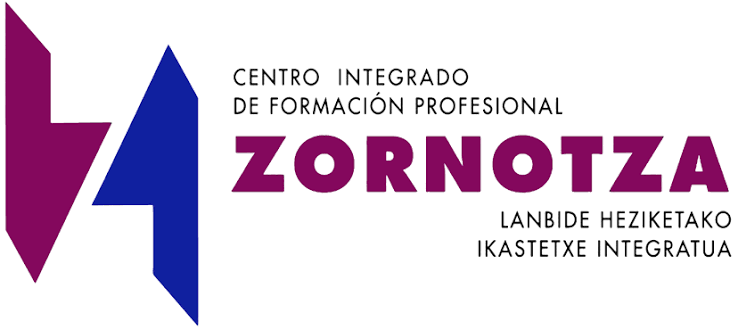

<p align="center"></p>

<a id="castellano"></a>

# Proyectos intermodulares · CIFP Zornotza LHII

**Euskaraz:** [irakurri behean ↓](#euskaraz)

Web donde el alumnado de **SMR (2SM), DAW (WG) y DAM (PG)** publica su proyecto intermodular, y el servidor que la
sirve (Ubuntu en IsardVDI, Docker). Cada proyecto es una tarjeta con título, imagen, etiqueta del ciclo y enlace a
su landing; con cuenta del centro se puede reaccionar a los proyectos de los demás grupos.

```
http://IP-DEL-SERVIDOR/proyectos/                       → portada: proyecto destacado + 3 destacados + "ver todos"
http://IP-DEL-SERVIDOR/proyectos/galeria                → galería con filtros por ciclo y buscador
http://IP-DEL-SERVIDOR/proyectos/p/<ciclo>/<carpeta>/   → landing de cada proyecto
```

## Índice

- [Estructura del repositorio](#estructura-del-repositorio)
- [Cómo publica un grupo su proyecto](#cómo-publica-un-grupo-su-proyecto)
- [Qué entregan todos los grupos](#qué-entregan-todos-los-grupos)
- [Retos de cada ciclo](#retos-de-cada-ciclo)
- [Documentación técnica](#documentación-técnica)
- [Euskaraz](#euskaraz)

## Estructura del repositorio

| Carpeta | Qué es | Empezar por |
|---|---|---|
| [`proyectos/`](proyectos/) | **Los proyectos del alumnado**: una carpeta por grupo con `proyecto.json`, `index.html` y portada. Se publican por pull request | [`proyectos/LEEME.md`](proyectos/LEEME.md) |
| [`apps/proyectos/`](apps/proyectos/) | La web (React + Vite + Tailwind, servida por nginx) y su API (Node sin dependencias): sesión, reacciones, administración con `admin.sh` | [`apps/proyectos/LEEME.md`](apps/proyectos/LEEME.md) |
| [`proxy/`](proxy/) | Reverse proxy en el 80 (`/` → `/proyectos/`) | [`proxy/nginx.conf`](proxy/nginx.conf) |
| [`servidor/`](servidor/) | Instalación del servidor desde cero y despliegue (a mano, desde Windows o por GitHub Actions) | [`servidor/LEEME.md`](servidor/LEEME.md) |
| [`scripts/`](scripts/) | [`validar-proyectos.js`](scripts/validar-proyectos.js): las reglas que comprueba cada pull request | — |
| [`e2e/`](e2e/) | Pruebas de extremo a extremo (Playwright en Docker) contra la web tal como se despliega | [`e2e/LEEME.md`](e2e/LEEME.md) |
| [`docker-compose.yml`](docker-compose.yml) | Arranca el proxy e incluye el compose de la web (`docker compose up -d --build` desde la raíz) | — |

## Cómo publica un grupo su proyecto

Fork → copiar [`proyectos/_plantilla/`](proyectos/_plantilla/) a `proyectos/<ciclo>/<nombre-del-proyecto>/` → rellenar `proyecto.json` y la
landing → pull request. [`validar-pr.yml`](.github/workflows/validar-pr.yml) comprueba la carpeta y que la PR no toque nada más; al aceptarla,
[`desplegar.yml`](.github/workflows/desplegar.yml) entra en el servidor por el bastión de Isard y hace `git pull`. Guía completa: [`proyectos/LEEME.md`](proyectos/LEEME.md).

## Qué entregan todos los grupos

- Una **landing** de presentación (plantilla con las 6 secciones que se evalúan: necesidad, solución, planificación, demo, seguimiento y control, equipo).
- Su **tarjeta** en la web (la carpeta con `proyecto.json`), con la etiqueta de su grado.
- Un **vídeo de 5 minutos** en el que se ve al alumnado hablando y la pantalla: solución, planificación, mini demo, seguimiento y control. Se enlaza, no se sube.
- Los grupos de grado superior, además, un **MVP** funcional relacionado con su ciclo.

El detalle de cada ciclo está en su reto: [2SM](https://github.com/CIFPZornotzaLHII/reto_intermodular_2sm), [WG](https://github.com/CIFPZornotzaLHII/reto_intermodular_wg), [PG](https://github.com/CIFPZornotzaLHII/reto_intermodular_pg).

## Retos de cada ciclo

El enunciado de cada reto (qué hay que hacer, fases, rúbrica, ideas y plantillas) está en su propio repositorio:

| Ciclo | Reto | Proyectos publicados |
|---|---|---|
| SMR (2SM), grado medio | [`reto_intermodular_2sm`](https://github.com/CIFPZornotzaLHII/reto_intermodular_2sm) | [`proyectos/2SM/`](proyectos/2SM/) |
| DAW (WG), grado superior | [`reto_intermodular_wg`](https://github.com/CIFPZornotzaLHII/reto_intermodular_wg) | [`proyectos/WG/`](proyectos/WG/) |
| DAM (PG), grado superior | [`reto_intermodular_pg`](https://github.com/CIFPZornotzaLHII/reto_intermodular_pg) | [`proyectos/PG/`](proyectos/PG/) |

## Documentación técnica

- [`docs/SPEC.md`](docs/SPEC.md): qué se construye en este repo y qué no.
- [`docs/DECISIONS.md`](docs/DECISIONS.md): decisiones con fecha (la más reciente manda sobre la SPEC).
- [`apps/proyectos/LEEME.md`](apps/proyectos/LEEME.md): cómo funciona la web y su API.
- [`servidor/LEEME.md`](servidor/LEEME.md): instalación y despliegue del servidor.
- [`e2e/LEEME.md`](e2e/LEEME.md): pruebas de extremo a extremo.

---

<a id="euskaraz"></a>

# Proiektu intermodularrak · CIFP Zornotza LHII

**Castellano:** [leer arriba ↑](#castellano)

SMR (2SM), DAW (WG) eta DAMeko (PG) ikasleek beren proiektu intermodularra argitaratzen duten webgunea, eta hura
zerbitzatzen duen zerbitzaria (Ubuntu IsardVDIn, Docker). Proiektu bakoitza txartel bat da: izenburua, irudia,
zikloaren etiketa eta landingerako esteka. Ikastetxeko kontuarekin, beste taldeen proiektuei erreakzionatu daiteke.

```
http://ZERBITZARIAREN-IP/proyectos/                       → azala: proiektu nabarmendua + 3 nabarmendu + "ikusi denak"
http://ZERBITZARIAREN-IP/proyectos/galeria                → galeria, ziklokako iragazkiekin eta bilatzailearekin
http://ZERBITZARIAREN-IP/proyectos/p/<zikloa>/<karpeta>/  → proiektu bakoitzaren landinga
```

Errepositorioaren dokumentazio teknikoa (LEEME.md fitxategiak, SPEC eta DECISIONS) gaztelaniaz dago.

## Aurkibidea

- [Errepositorioaren egitura](#errepositorioaren-egitura)
- [Talde batek nola argitaratzen duen bere proiektua](#talde-batek-nola-argitaratzen-duen-bere-proiektua)
- [Talde guztiek zer entregatzen duten](#talde-guztiek-zer-entregatzen-duten)
- [Ziklo bakoitzaren erronka](#ziklo-bakoitzaren-erronka)
- [Dokumentazio teknikoa](#dokumentazio-teknikoa)

## Errepositorioaren egitura

| Karpeta | Zer den | Hasteko |
|---|---|---|
| [`proyectos/`](proyectos/) | **Ikasleen proiektuak**: karpeta bat talde bakoitzeko, `proyecto.json`, `index.html` eta azalarekin. Pull request bidez argitaratzen dira | [`proyectos/LEEME.md`](proyectos/LEEME.md) |
| [`apps/proyectos/`](apps/proyectos/) | Webgunea (React + Vite + Tailwind, nginx-ek zerbitzatua) eta haren APIa (Node, mendekotasunik gabe): saioa, erreakzioak, administrazioa `admin.sh`-rekin | [`apps/proyectos/LEEME.md`](apps/proyectos/LEEME.md) |
| [`proxy/`](proxy/) | Reverse proxy-a 80 atakan (`/` → `/proyectos/`) | [`proxy/nginx.conf`](proxy/nginx.conf) |
| [`servidor/`](servidor/) | Zerbitzaria hutsetik instalatzea eta hedatzea (eskuz, Windowsetik edo GitHub Actions bidez) | [`servidor/LEEME.md`](servidor/LEEME.md) |
| [`scripts/`](scripts/) | [`validar-proyectos.js`](scripts/validar-proyectos.js): pull request bakoitzean egiaztatzen diren arauak | — |
| [`e2e/`](e2e/) | Muturretik muturrerako probak (Playwright Dockerren), hedatzen den bezalako webgunearen kontra | [`e2e/LEEME.md`](e2e/LEEME.md) |
| [`docker-compose.yml`](docker-compose.yml) | Proxy-a abiarazten du eta webaren compose-a barne hartzen du (`docker compose up -d --build` errotik) | — |

## Talde batek nola argitaratzen duen bere proiektua

Fork → kopiatu [`proyectos/_plantilla/`](proyectos/_plantilla/) `proyectos/<zikloa>/<proiektuaren-izena>/` karpetara → bete `proyecto.json` eta
landinga → pull request. [`validar-pr.yml`](.github/workflows/validar-pr.yml) fitxategiak karpeta egiaztatzen du, eta PRak beste ezer ukitzen ez duela; onartzean,
[`desplegar.yml`](.github/workflows/desplegar.yml) zerbitzarira sartzen da Isarden bastioitik eta `git pull` egiten du. Gida osoa (gaztelaniaz): [`proyectos/LEEME.md`](proyectos/LEEME.md).

## Talde guztiek zer entregatzen duten

- Aurkezpeneko **landing** bat (ebaluatzen diren 6 atalak dituen txantiloia: beharra, irtenbidea, plangintza, demoa, jarraipena eta kontrola, taldea).
- Beren **txartela** webgunean (`proyecto.json` duen karpeta), beren mailaren etiketarekin.
- **5 minutuko bideo** bat, ikasleak hizketan eta pantaila ikusten direla: irtenbidea, plangintza, mini demoa, jarraipena eta kontrola. Estekatu egiten da, ez da igotzen.
- Goi mailako taldeek, gainera, beren zikloarekin lotutako **MVP** funtzional bat.

Ziklo bakoitzaren xehetasunak bere erronkan daude: [2SM](https://github.com/CIFPZornotzaLHII/reto_intermodular_2sm), [WG](https://github.com/CIFPZornotzaLHII/reto_intermodular_wg), [PG](https://github.com/CIFPZornotzaLHII/reto_intermodular_pg).

## Ziklo bakoitzaren erronka

Erronka bakoitzaren enuntziatua (zer egin behar den, faseak, errubrika, ideiak eta txantiloiak) bere errepositorioan dago:

| Zikloa | Erronka | Argitaratutako proiektuak |
|---|---|---|
| SMR (2SM), erdi maila | [`reto_intermodular_2sm`](https://github.com/CIFPZornotzaLHII/reto_intermodular_2sm) | [`proyectos/2SM/`](proyectos/2SM/) |
| DAW (WG), goi maila | [`reto_intermodular_wg`](https://github.com/CIFPZornotzaLHII/reto_intermodular_wg) | [`proyectos/WG/`](proyectos/WG/) |
| DAM (PG), goi maila | [`reto_intermodular_pg`](https://github.com/CIFPZornotzaLHII/reto_intermodular_pg) | [`proyectos/PG/`](proyectos/PG/) |

## Dokumentazio teknikoa

- [`docs/SPEC.md`](docs/SPEC.md): errepositorio honetan zer eraikitzen den eta zer ez.
- [`docs/DECISIONS.md`](docs/DECISIONS.md): erabakiak, datarekin (berriena SPECaren gainetik dago).
- [`apps/proyectos/LEEME.md`](apps/proyectos/LEEME.md): webgunea eta haren APIa nola dabiltzan.
- [`servidor/LEEME.md`](servidor/LEEME.md): zerbitzariaren instalazioa eta hedapena.
- [`e2e/LEEME.md`](e2e/LEEME.md): muturretik muturrerako probak.
